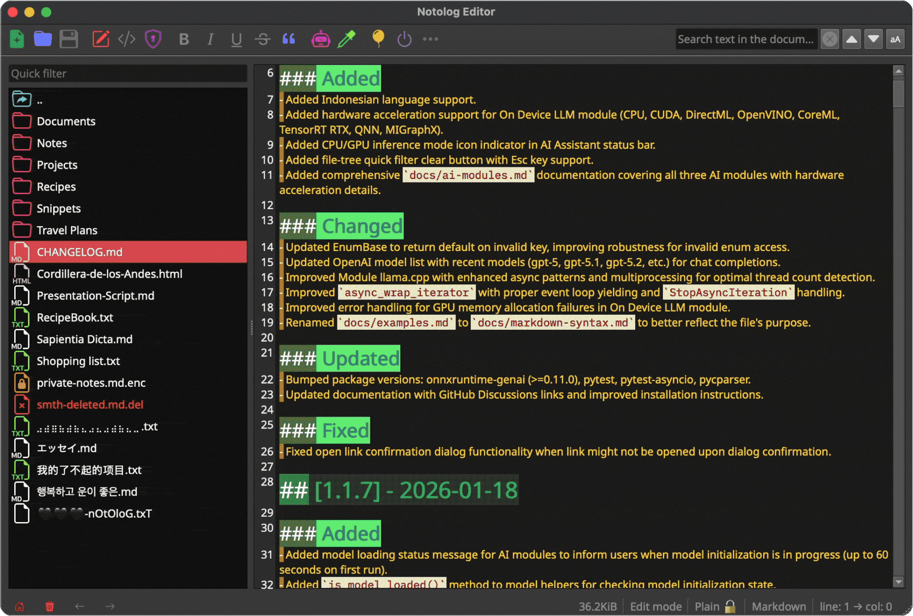

# AI Assistant Guide

Notolog includes an AI-powered assistant that supports multiple backends for text generation and assistance.

## Table of Contents

- [Overview](#overview)
- [Supported Backends](#supported-backends)
- [OpenAI API Setup](#openai-api-setup)
- [On-Device LLM (ONNX)](#on-device-llm-onnx)
- [Module llama.cpp (GGUF)](#module-llamacpp-gguf)
- [Using the AI Assistant](#using-the-ai-assistant)
- [Best Practices](#best-practices)
- [Troubleshooting](#troubleshooting)

---



## Overview

The AI Assistant provides:

- **Chat-style interface** for natural conversations
- **Context-aware responses** with prompt history
- **Multiple backends** for flexibility
- **Privacy options** with local LLM support

Access via: `Tools` → `AI Assistant`

---

## Supported Backends

| Backend | Model Format | Requirements | Privacy |
|---------|--------------|--------------|---------|
| OpenAI API | Cloud-based | API key, internet | Cloud processed |
| On-Device LLM | ONNX | Compatible GenAI model/runtime and sufficient memory | Local inference |
| Module llama.cpp | GGUF | Compatible model/runtime; compiler if building from source | Local inference |

---

## OpenAI API Setup

### Requirements

- OpenAI API account
- Valid API key
- Internet connection

### Configuration

1. Go to `Settings` → `OpenAI API` tab
2. Enter your API URL (default: OpenAI endpoint)
3. Enter your API key in the secure field
4. Configure optional settings:

| Setting | Description | Default |
|---------|-------------|-------|
| API URL | API endpoint URL | `https://api.openai.com/v1/chat/completions` |
| API Key | Your OpenAI API key (stored encrypted) | (required) |
| Supported Models | GPT model to use | gpt-5.2 |
| System Prompt | Initial context/instructions | (empty) |
| Temperature | Response creativity (0-100 → 0.0-1.0) | 20 (0.2) |
| Maximum Response Tokens | Response limit; 0 leaves the limit to the API service | 0 |
| Prompt History Size | Number of turns to remember | 0 |

### Security Notes

The API key, prompt, system prompt, and included conversation history are sent to the configured
endpoint, which may be OpenAI or another compatible service. Verify the URL and use HTTPS for remote endpoints.
Keys are encrypted in local settings with an application key, not stored in an OS credential vault.
Anyone with access to both the settings and that key can recover them. The API key is configured in Settings;
Notolog does not automatically read the OpenAI SDK's environment variables.

---

## On-Device LLM (ONNX)

Run AI models locally using ONNX Runtime GenAI.

### Requirements

- Python 3.11–3.14
- Enough RAM or VRAM for the selected model and context
- A model exported for the installed ONNX Runtime GenAI version

### Supported Models

Choose an ONNX Runtime GenAI export containing `genai_config.json` and all referenced files.
Use the model card to check runtime and execution-provider compatibility.
The [Microsoft model collection](https://huggingface.co/microsoft){:target="_blank"}
and [Hugging Face ONNX catalog](https://huggingface.co/models?library=onnx){:target="_blank"}
include model exports; check each export rather than relying on its ONNX label alone.

### Configuration

1. Go to `Settings` → `On Device LLM` tab
2. Set **ONNX Model Location** to your ONNX model directory
3. Configure generation parameters:

| Setting | Description | Default |
|---------|-------------|---------|
| ONNX Model Location | Path to ONNX model directory | (required) |
| Temperature | Response randomness (0-100 → 0.0-1.0) | 20 (0.2) |
| Maximum Response Tokens | GenAI sequence-length limit; 0 uses the module default of 4096 | 0 |
| Prompt History Size | Number of turns to remember | 0 |

### First Run Notice

!!! warning "Model Loading Time"
    Loading time depends on the model, storage, and available memory. The application displays a loading message.
    Subsequent requests can reuse the loaded model.

### Model Directory Structure

Your ONNX model directory should contain:
```
model_directory/
├── model.onnx           # Main model file
├── model.onnx.data      # Model weights (if separate)
├── tokenizer.json       # Tokenizer configuration
└── genai_config.json    # ONNX Runtime GenAI configuration
```

Filenames vary by export. Download the complete model directory referenced by `genai_config.json`
and check compatibility with the installed GenAI version. See [AI Modules](ai-modules.md#on-device-llm-onnx).

---

## Module llama.cpp (GGUF)

Run GGUF-format models using llama.cpp bindings.

### Requirements

- `llama-cpp-python` package
- C++ compiler when building llama-cpp-python from source
- Enough RAM or VRAM for the selected model and context
- GGUF model file

### Installation

```bash
# Option 1: Install with Notolog extras
pip install "notolog[llama]"

# Option 2: Install separately
pip install llama-cpp-python

# Linux users may need:
sudo apt-get install build-essential
```

### Supported Models

GGUF models from:
- [Hugging Face GGUF Models](https://huggingface.co/models?library=gguf){:target="_blank"}
- [TheBloke's GGUF collection](https://huggingface.co/TheBloke){:target="_blank"}

Recommended quantizations:
- `Q4_K_M` - Good balance of size/quality
- `Q5_K_M` - Better quality, larger size
- `Q8_0` - Near-original quality

### Configuration

1. Go to `Settings` → `Module llama.cpp` tab
2. Set **Model Location** to your `.gguf` file
3. Configure parameters:

| Setting | Description | Default |
|---------|-------------|---------|
| Model Location | Path to `.gguf` model file | (required) |
| Context Window Size | Token context size (1-65536) | 2048 |
| Chat Formats | Model's chat template | chatml |
| System Prompt | Initial instructions for the model | (empty) |
| Response Temperature | Response randomness (0-100 → 0.0-1.0) | 20 (0.2) |
| Max Tokens per Response | Response limit; 0 uses the available context window | 0 |
| Size of the Prompt History | Number of turns to remember | 0 |

### Chat Formats

Select the template specified by your model card:

* `chatml` - ChatML models (default)
* `llama-2` - Meta's Llama 2 models
* `gemma` - Google's Gemma models

The selector offers these three formats. Models requiring other templates are not supported
through this setting; a GGUF file alone does not guarantee compatibility.

---

## Using the AI Assistant

### Basic Workflow

1. Open AI Assistant
2. Select your preferred backend in Settings
3. Type your prompt in the input field
4. Press `Enter` or click Send
5. Wait for the response

### Multi-line Prompts

For longer prompts:
* Use `Ctrl+Enter` for new lines
* Press `Enter` to send

### Prompt Tips

**Be Specific**:
```
❌ "Write about Python"
✅ "Explain Python list comprehensions with 3 examples"
```

**Provide Context**:
```
"I'm writing a Markdown document about gardening. 
Suggest 5 section headers for a beginner's guide."
```

**Request Format**:
```
"List the steps to install Notolog on Ubuntu.
Format as a numbered list with code blocks."
```

### Token Usage

The status area shows:
- **Input tokens**: Your prompt size
- **Output tokens**: Response size
- **Total tokens**: Combined usage

---

## Best Practices

### For Privacy

1. Use local models (ONNX or GGUF) for sensitive content
2. Review system prompts before sending
3. Clear chat history when done with sensitive topics

### For Performance

1. Start with a smaller model that fits the available RAM or VRAM
2. Use quantized models (Q4_K_M) for speed
3. Increase context window only if needed
4. Close other applications when using large models

### For Quality

1. Use appropriate temperature:
   - Low (0.1-0.3): Factual, consistent
   - Medium (0.4-0.7): Balanced
   - High (0.8-1.0): Creative, varied
2. Provide clear, specific prompts
3. Use system prompts to set context

---

## Troubleshooting

### "Model not found" Error

**Cause**: Invalid model path or corrupted model files.

**Solution**:
1. Verify the model path in Settings
2. Check that model files exist and are complete
3. Ensure file permissions allow reading

### ONNX Model Takes Too Long to Load

**Cause**: First-time model initialization.

**Solution**:
- Allow time for the model size and available hardware
- Keep the model loaded to reuse it for subsequent requests
- A loading message will be displayed

### llama-cpp-python Installation Fails

**Cause**: Missing C++ compiler.

**Solution**:
```bash
# Ubuntu/Debian
sudo apt-get install build-essential

# Fedora
sudo dnf install gcc-c++

# macOS
xcode-select --install
```

### Out of Memory Errors

**Cause**: Model too large for available RAM.

**Solution**:
1. Use smaller quantized models
2. Close other applications
3. Reduce context window size
4. Consider cloud API instead

## API Reference

For developers extending AI functionality, see:
- [API Reference - Module Architecture](api-reference.md#module-architecture)
- [Creating Custom Modules](api-reference.md#creating-custom-modules)

---

*For general configuration, see [Configuration Guide](configuration.md).*
