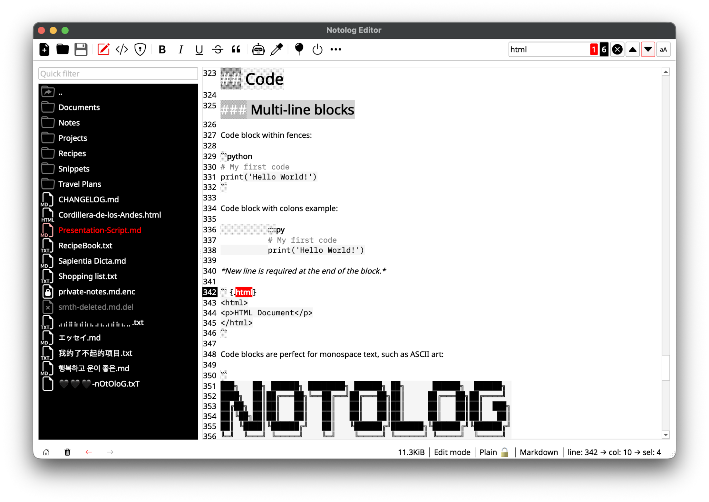

# User Guide

Complete guide to all Notolog features and functionality.

## Table of Contents

- [Markdown Editing](#markdown-editing)
- [View Mode](#view-mode)
- [File Management](#file-management)
- [Search Features](#search-features)
- [Keyboard Shortcuts](#keyboard-shortcuts)
- [Text-to-Speech](text-to-speech.md)
- [Encryption](#encryption)
- [Themes](#themes)
- [Multi-Language Support](#multi-language-support)
- [Settings Overview](#settings-overview)
- [Privacy and Network Activity](#privacy-and-network-activity)

---

## Markdown Editing

### Syntax Highlighting

Notolog provides real-time syntax highlighting for:

- **Headers** (`# H1`, `## H2`, etc.)
- **Bold** (`**text**`) and *Italic* (`*text*`)
- **Code blocks** (fenced with ``` or indented)
- **Links** (`[text](https://notolog.app)`)
- **Lists** (ordered and unordered)
- **Blockquotes** (`> quote`)
- **Tables**
- **TODO items** (`@todo`)

### Supported Markdown Extensions

Notolog uses the Python Markdown library with these extensions:

| Extension       | Description |
|-----------------|-------------|
| `extra`         | Abbreviations, attribute lists, definition lists, fenced code, footnotes, tables, Markdown in HTML |
| `toc`           | Table of Contents with header anchors |
| `codehilite`    | Syntax highlighting for code blocks |

### Code Blocks

Fenced code blocks with language specification:

~~~markdown
```python
def hello():
    print("Hello, Notolog!")
```
~~~

### TODO Highlighting

The `@todo` tag is a Notolog-exclusive feature (not standard Markdown). It is highlighted in both Edit and View modes for easy task tracking:

```markdown
@todo Review documentation
@todo Add more examples
```

For more syntax examples, see the [Markdown Syntax Guide](markdown-syntax.md).

---

## View Mode

Toggle between Edit and View modes:

- **Edit Mode**: Write and modify Markdown
- **View Mode**: See rendered HTML output

### View Features

- Rendered Markdown with proper styling
- Clickable links (opens in browser)
- Syntax-highlighted code blocks
- Image display (local and remote) - see [Image Handling](#image-handling) below
- Table formatting

### Image Handling

Notolog displays local and remote images. Remote images are cached in memory when space is
available and saved unencrypted to a local `images` directory by default, including images
referenced by encrypted notes.

Configure in `Settings` → `Workspace` → `View mode` → `Auto-save external images to disk`.
Turning this off prevents new saved copies; it does not remove existing copies or stop downloads.

Remote image downloads are limited to 16 MiB per image and 60 seconds overall,
with a 30-second inactivity timeout. Images must decode successfully and contain no more than
16,777,216 pixels. Saved copies use an extension matching the detected image format;
URL query strings are excluded from the filename. Valid older cached images remain available.
Larger images can be saved separately and linked locally.

---

## File Management

### File Tree

The left panel shows your notes directory:

- **Folders**: Displayed with folder icon
- **Markdown and plain text files**: `.md`, `.txt`, `.htm`, `.html`
- **Encrypted files**: `.enc` extension

### Creating Files and Folders

**New File**:

- Toolbar → `New File`

**New Folder**:

- Right-click on empty space in the file tree → `New Folder`

### Renaming and Deleting

- Right-click on file/folder → `Rename` or `Delete`
- Confirmation dialog prevents accidental deletion

**Litter Bin**: Deletion is reversible by default. Deleted files are marked as deleted but remain on disk. When the "Litter bin" option is active (icon below the file tree), deleted files are visible and can be:

- **Restored**: Right-click → Restore
- **Deleted completely**: Right-click → Delete completely

To make regular deletion permanent, disable `Settings` → `General` → `Delete files reversibly`. Existing `.del` files remain available through the Litter Bin until restored or deleted completely.

!!! note "Important Note"
    When the Litter bin is inactive, deleted files are hidden from the file tree but still exist on disk and can be found via your system's file manager.

### File Meta-Headers

Notolog stores metadata in HTML comment headers:

```html
<!-- {"notolog.app": {"created": "2026-01-01 00:00:00", "updated": "2026-01-01 00:00:00", ...}} -->
# My Note
```

This preserves:
- Creation timestamp
- Last modification time

---

## Search Features

### In-File Search

Press `Ctrl+F` (`Cmd+F` on macOS) to open the search bar:

- **Case Sensitive**: Toggle with button
- **Navigation**: Previous/Next match buttons
- **Counter**: Shows "X of Y" matches

### Quick File Filter

Type in the file tree search box to filter:

- Filters by filename
- Real-time filtering
- Clear with the clear button or `Esc`

---

## Keyboard Shortcuts

Open **Settings > Workspace** to see the scrollable **Hotkeys** table with shortcuts
for your operating system. On macOS, the Command key is shown as `⌘`; for example,
Go to line appears as `⌘G`. The table below spells it out as `Cmd+G`.

| Action | Windows / Linux | macOS |
| --- | --- | --- |
| Save current note | Ctrl+S | Cmd+S |
| Find | Ctrl+F | Cmd+F |
| Go to line | Ctrl+G | Cmd+G |
| Undo | Ctrl+Z | Cmd+Z |
| Redo | Ctrl+Y on Windows; Ctrl+Shift+Z on Linux | Cmd+Shift+Z |
| Cut / Copy / Paste | Ctrl+X / Ctrl+C / Ctrl+V | Cmd+X / Cmd+C / Cmd+V |
| Select all | Ctrl+A | Cmd+A |
| Unindent | Shift+Tab | Shift+Tab |
| Insert newline | Shift+Enter | Shift+Return |

**Go to line** accepts a whole number from 1 to the active document's line count.
The dialog starts at the current line and restricts input to that range; canceling
keeps the cursor unchanged. In Edit mode, lines are source lines, independent of
word wrapping. In View mode, numbering follows displayed text blocks, such as
paragraphs and headings, so it may differ from the Markdown source.
The destination is brought into view.

---

## Encryption

Notolog provides AES-128 encryption for sensitive notes.

### Encryption Details

| Property | Value |
|----------|-------|
| Algorithm | AES-128 CBC (via Fernet) |
| Key Derivation | PBKDF2HMAC with SHA-256 |
| Iterations | 768,000 |
| Salt | 32 bytes, cryptographically random |

### Encrypting a File

1. Open the file you want to encrypt
2. Go to `File` → `Encrypt File` (or toolbar button)
3. Enter a strong password
4. Optionally add a password hint (avoid using personal info like date of birth - use something memorable yet unique that won't give clues if the file is accessed by others)
5. File is saved with `.enc` extension
6. After Notolog successfully reopens the encrypted file, choose whether to remove the unencrypted source. Removal follows the `Delete files reversibly` setting.

### Opening Encrypted Files

1. Click on `.enc` file
2. Enter your password
3. File decrypts in memory
4. Edit and save as normal

**Save As** preserves the note's encryption and password, regardless of the destination extension.
Use **Decrypt File** to create an unencrypted copy. Linked images are separate files and are not
protected by note encryption; see [Image Handling](#image-handling).

### Password Best Practices

- Use strong, unique passwords
- Consider a password manager
- Password hints are stored unencrypted
- No password recovery - keep backups!

---

## Themes

Notolog includes 6 built-in themes:

| Theme | Description |
|-------|-------------|
| **Default** | Clean, neutral design |
| **Calligraphy** | Rice paper aesthetic with ink-style text |
| **Nocturne** | Dark theme for night work |
| **Noir Dark** | High-contrast dark theme |
| **Spooky** | Halloween-inspired colors |
| **Strawberry** | Playful, warm colors |

### Changing Themes

`Settings` → `General` tab → `Theme`

Changes apply immediately, no app reload needed.


---

## Multi-Language Support

Notolog supports 19 languages:

- English (default)
- Chinese (Simplified) - 简体中文
- Dutch - Nederlands
- Finnish - Suomi
- French - Français
- Georgian - ქართული
- German - Deutsch
- Greek - Ελληνικά
- Hindi - हिन्दी
- Indonesian - Bahasa Indonesia
- Italian - Italiano
- Japanese - 日本語
- Korean - 한국어
- Latin - Latina
- Portuguese - Português
- Russian - Русский
- Spanish - Español
- Swedish - Svenska
- Turkish - Türkçe

### Changing Language

`Settings` → `General` → `Language`

Interface labels update immediately, including settings and TTS controls.
The selected speech language is independent of the interface language.

---

## Settings Overview

Access via `Settings` menu or toolbar.

### General Tab

- **Language**: UI language
- **Theme**: Visual theme selection
- **Default folder for notes**: Primary directory for notes
- **Show Main Menu**: Toggle main menu visibility
- **Font Size**: Adjust text size (range: 5-42)
- **Delete files reversibly**: Move deleted files to Notolog's litter bin instead of deleting them permanently

### Workspace Tab

**Editor mode**

- **Show Line Numbers**: Display line numbers in the editor

**View mode**

- **Convert Text Emojis to Graphics**: Render emojis graphically
- **Highlight TODOs**: Emphasize @todo tags
- **Require Confirmation to Open Links**: Show confirmation dialog before opening external links in your browser
- **Auto-save external images to disk**: Save downloaded images locally

**Bottom bar**

- **Show Navigation Arrows**: Display navigation arrows
- **Show Global Cursor Position**: Display the global cursor position
- **Show CPU and memory graphs**: Display live system-usage graphs
- **Graph refresh interval**: Set the sampling interval from 250 to 60000 ms

### AI Config Tab

- **Active Inference Module**: Select from available AI inference modules
- **Multi-turn dialogue with conversational memory**: Enable multi-turn dialogue that retains the previous prompt
- **Convert the result to Markdown**: Convert AI output to Markdown format

See [AI Assistant Guide](ai-assistant.md) for AI module-specific settings.

---

## Privacy and Network Activity

Notes and settings are stored on your device; file encryption is optional. Third-party libraries,
runtimes, and services have their own diagnostic behavior and privacy policies.

- **Local AI and speech**: Inference runs locally after the required models and runtimes are installed.
- **API backend**: Prompts, included conversation history, and credentials go to the configured endpoint,
  which may be OpenAI or another compatible service. That service's privacy terms apply.
- **Downloads and web resources**: Model downloads, remote document images, links opened in a browser,
  and update checks can contact external services. Update checks query the latest published release
  in Notolog's GitHub repository.
- **Local diagnostics**: Debug logging can include document or conversation content. Review logs before sharing them.

For speech-specific storage and privacy details, see the [Text-to-Speech Guide](text-to-speech.md#performance-and-privacy).

---

*For AI features, continue to the [AI Assistant Guide](ai-assistant.md).*
